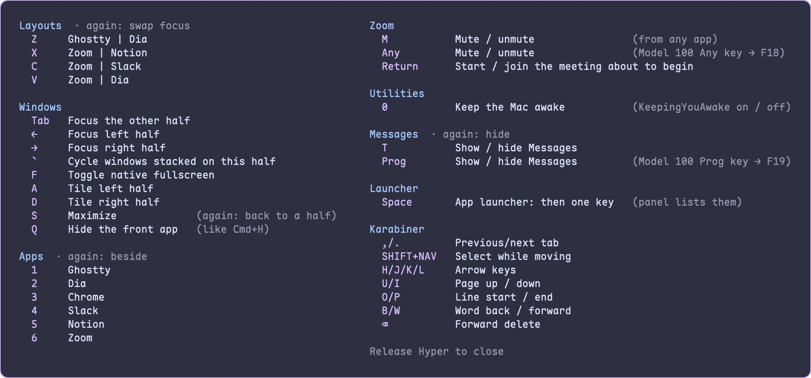
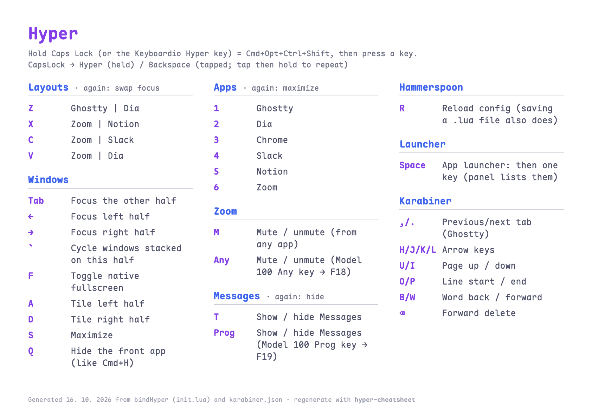

# dotfiles

[](https://github.com/jbrunclik/dotfiles/actions/workflows/ci.yml)

A keyboard-first macOS setup, built around one **Hyper** key that works the
same on a MacBook and a Keyboardio Model 100. Catppuccin Mocha everywhere.

## Highlights

- **One Hyper key, two keyboards.** Caps Lock on the MacBook, the thumb key
  on the Model 100 — Cmd+Option+Ctrl+Shift, a modifier no app uses. Shortcuts
  are bound to physical keys, so they stay put when switching to the Czech
  (QWERTZ) layout.
- **Windows and apps on one hand.** Hyper+Z/X/C/V tile a pair of apps side by
  side (press again to swap focus), Hyper+1–6 jump to an app, Hyper+A/S/D
  tile or maximize. Messages pops over the current layout and hides again
  (Hyper+T); Zoom mutes from any app (Hyper+M, or one key on the Model 100).
- **A nav layer under the right hand.** Hyper+H/J/K/L are arrows; U/I page,
  O/P line start/end, B/W word jumps — in every app, terminal included.
- **It documents itself.** Hold Hyper alone for an on-screen cheatsheet; hold
  it on the Model 100 and the bound keys light up by what they do; run
  `hyper-cheatsheet` for a printable PDF. All three are generated from the
  config, so they can't drift from it.
- **Keyboard firmware as code.** The Model 100's keymap and colors are backed
  up into the repo and its lit Hyper layer is generated from the dotfiles.
- **Kept honest.** `drift.sh` checks the machine against the repo, CI lints
  every push, a global pre-commit hook scans for secrets, and a Claude Code
  hook validates every config file as it's edited.

| On screen: hold Hyper | On the desk: `hyper-cheatsheet` |
|---|---|
|  |  |

See **[GUIDE.md](GUIDE.md)** for every shortcut, the reasoning behind it, and
what to watch out for.

## What's included

**Terminal and shell**

| Component | Tool | Config |
|---|---|---|
| Terminal | [Ghostty](https://ghostty.org/) — tabs on Hyper+,/., `sudo` keeps its terminfo | `config/ghostty/config` |
| Shell | Bash + [Starship](https://starship.rs/), [fzf](https://github.com/junegunn/fzf) on `fd` with previews, [zoxide](https://github.com/ajeetdsouza/zoxide) | `bash_profile`, `inputrc`, `config/starship.toml` |
| Modern CLI | `bat`, `eza`, `fd`, `ripgrep`, `dust`, `btop`, `delta`, `tldr`, `bat-extras`, `just` | `Brewfile`, `config/bat/` |
| Runtimes | [mise](https://mise.jdx.dev/) for Node, Go and Java; `uv` and `ruff` for Python | `config/mise/config.toml` |
| SSH | Agent, keepalive, one reused connection per host | `ssh_config` |

**Keyboard and windows**

| Component | Tool | Config |
|---|---|---|
| Hyper key, nav layer | [Karabiner-Elements](https://karabiner-elements.pqrs.org/) — Caps Lock is Hyper when held, Backspace when tapped | `config/karabiner/` |
| Keyboardio Model 100 | Firmware keymap with a lit Hyper layer — `keyboardio-layers`, `keyboardio-backup` | `config/keyboardio/model100.json` |
| Windows, apps, cheatsheet | [Hammerspoon](https://www.hammerspoon.org/) — layouts, app focus, Messages, Zoom mute; reloads on save | `config/hammerspoon/` |

**Editors and Git**

| Component | Tool | Config |
|---|---|---|
| IDE | [VS Code](https://code.visualstudio.com/) with Catppuccin, Ruff, Prettier | `config/vscode/` |
| Editor | [Neovim](https://neovim.io/) with LSP, Treesitter, Copilot | `config/nvim/` |
| Git | [delta](https://github.com/dandavison/delta), [lazygit](https://github.com/jesseduffield/lazygit), [gh](https://cli.github.com/), secret-scanning pre-commit hook | `gitconfig`, `config/git/hooks/`, `config/gh/` |
| Claude Code | [ccstatusline](https://github.com/sirmalloc/ccstatusline) status line matching Starship | `config/ccstatusline/`, `config/claude/` |

**macOS**

| Component | Tool | Config |
|---|---|---|
| System settings | Fast key repeat, Dock on the right, fixed Spaces, Touch ID for `sudo`, … | `install.sh` |
| Default apps | Finder "open with" per file type — text/code → VS Code, media → IINA, archives → The Unarchiver | `config/finder/default-apps` |
| Utilities | [Maccy](https://maccy.app/) clipboard, [Shottr](https://shottr.cc/) screenshots, AlDente, KeepingYouAwake | `Brewfile`, `install.sh` |
| Packages | [Homebrew](https://brew.sh/), App Store apps via `mas` | `Brewfile` |

Font: [Maple Mono NF](https://github.com/subframe7536/maple-font), a rounded
monospace with Nerd Font icons.

## Install

```bash
git clone git@github.com:jbrunclik/dotfiles.git ~/src/dotfiles
cd ~/src/dotfiles
./install.sh
```

The install script:

1. Installs Homebrew packages from `Brewfile` (plus `~/Brewfile.local`, if
   present) and App Store apps via `mas` — sign in to the App Store first. A
   package that fails is reported, not fatal.
2. Symlinks every config file (existing files are backed up to `*.bak`).
3. Sets macOS defaults — accent color, key repeat, Dock and Spaces, Finder
   extensions, Touch ID for `sudo` — and a few app preferences (see
   [GUIDE.md](GUIDE.md#macos-settings)).
4. Sets Finder's default apps, configures Claude Code, installs VS Code
   extensions.
5. Warns about missing binaries and local-only files, then lists the manual
   steps (accessibility permissions, apps without a cask).

`install.sh` and `drift.sh` share one symlink manifest (`lib/links.sh`), so the
two can't disagree about what "installed" means.

### Files not in this repo

**This repo is public — no secret belongs in a tracked file.** These are
created by hand:

| File | Contents |
|---|---|
| `~/.bash_profile.local` | API tokens, machine-local env vars and `PATH` entries; sourced last |
| `~/Brewfile.local` | Work tools and this-machine-only apps; the `Brewfile` loads it if present |
| `~/.gitconfig.local` | `[user]` name and email, `[filter "lfs"]` |
| `~/.ssh/config.local` | Host entries |
| `~/.ssh/id_ed25519`, `.pub` | SSH key |

<details>
<summary>Examples</summary>

```gitconfig
# ~/.gitconfig.local
[user]
    name = Your Name
    email = you@example.com
```

```ssh-config
# ~/.ssh/config.local
Host myserver
    HostName myserver.example.com
    User myuser
```

</details>

## Keyboardio Model 100

The keymap lives in the keyboard's firmware, edited with Chrysalis. Two
scripts keep it in the repo (quit Chrysalis first — it holds the port):

- `keyboardio-backup` — reads every setting and writes
  `config/keyboardio/model100.json` in Chrysalis's own backup format, so
  Chrysalis can restore it.
- `keyboardio-layers` — builds the Hyper layer from the base layer and colors
  every layer: the Hyper layer by what each key does, read live from the same
  data as the on-screen cheatsheet. Dry run by default; `--apply` writes it and
  reads it back.

## Keeping it honest

- `./drift.sh` — symlinks, packages (missing is drift, merely outdated is a
  note), required binaries, local files, Neovim parsers, VS Code extensions,
  Touch ID for `sudo`. Non-zero exit on drift.
- CI lints every push: shellcheck, Python/Lua/JSON/YAML syntax, and that every
  binary a config shells out to has a Brewfile entry.
- A global pre-commit hook runs [gitleaks](https://github.com/gitleaks/gitleaks)
  on every commit, in every repo.
- Working on the repo with Claude Code: [CLAUDE.md](CLAUDE.md) holds the
  conventions and the after-every-change checklist, and a hook in
  `.claude/settings.json` validates each edited file — shellcheck, JSON, Lua,
  Karabiner lint, Ghostty config.
